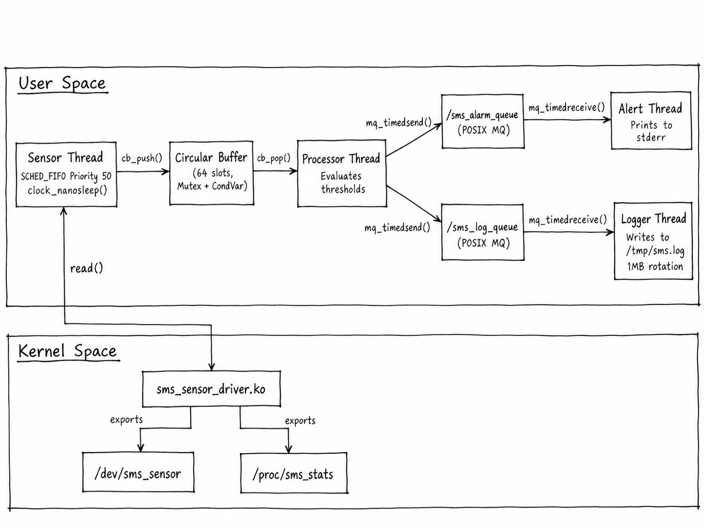
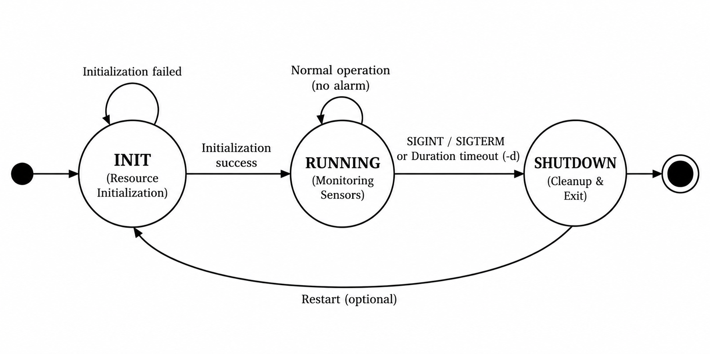

# FPT University - Linux and Open Source Platform (LOS201)

[](https://kernel.org)
[](https://developer.arm.com)
[](https://www.qemu.org)
[](https://en.wikipedia.org/wiki/C_(programming_language))

This repository contains all experimental deliverables, kernel source modifications, driver implementations, configurations, and formal technical reports for **Linux and Open Source Platform (LOS201)** at **FPT University - Ho Chi Minh City Campus**.

---

## 👥 Engineering Team Members

| Full Name | Roll Number |
| :--- | :---: |
| **Hoàng Ngọc Gia Bão** | **SE203238** |
| **Trần Hồ Khánh Tân** | **SE203740** |
| **Nguyễn Trọng Hùng** | **SE204352** |
| **Nguyễn Quế Vũ** | **SE204290** |
| **Nguyễn Việt Anh** | **SE204364** |
| **Hồ Phan Anh Tuấn** | **SE203437** |

- **Supervising Lecturer:** Mr. Phạm Thế Vinh

---

## 📂 Repository Structure

> *Click on any folder or file name below to navigate directly to its contents on GitHub.*

- [`lab01_kernel_boot/`](./lab01_kernel_boot/): Linux Kernel Configuration & System Boot on ARMv7 Architecture.
  * [`configs/`](./lab01_kernel_boot/configs/): Kernel and BusyBox build configurations ([`kernel.config`](./lab01_kernel_boot/configs/kernel.config), [`busybox.config`](./lab01_kernel_boot/configs/busybox.config)).
  * [`rootfs/`](./lab01_kernel_boot/rootfs/): Minimal BusyBox-based root filesystem and startup scripts ([`initramfs/etc/inittab`](./lab01_kernel_boot/rootfs/initramfs/etc/inittab), [`init.d/rcS`](./lab01_kernel_boot/rootfs/initramfs/etc/init.d/rcS)).
  * [`output/`](./lab01_kernel_boot/output/): Generated ARM boot artifacts ([`zImage`](./lab01_kernel_boot/output/zImage), [`vexpress-v2p-ca9.dtb`](./lab01_kernel_boot/output/vexpress-v2p-ca9.dtb), [`initramfs.cpio.gz`](./lab01_kernel_boot/output/initramfs.cpio.gz)).
  * [`report/`](./lab01_kernel_boot/report/): Formal technical PDF laboratory report ([`Lab01.pdf`](./lab01_kernel_boot/report/Lab01.pdf)).

- [`lab02_device_driver/`](./lab02_device_driver/): Writing Character Device Drivers & Flash Filesystem Management.
  * [`driver/`](./lab02_device_driver/driver/): Kernel module source and compiled binary ([`lab2_driver.c`](./lab02_device_driver/driver/lab2_driver.c), [`lab2_driver.ko`](./lab02_device_driver/driver/lab2_driver.ko), [`Makefile`](./lab02_device_driver/driver/Makefile)).
  * [`rootfs/`](./lab02_device_driver/rootfs/): Validation shell scripts ([`test_driver.sh`](./lab02_device_driver/rootfs/test_driver.sh), [`test_procfs.sh`](./lab02_device_driver/rootfs/test_procfs.sh)).
  * [`logs/`](./lab02_device_driver/logs/): Execution terminal outputs ([`boot_log.txt`](./lab02_device_driver/logs/boot_log.txt), [`driver_test.txt`](./lab02_device_driver/logs/driver_test.txt), [`mtd_jffs2.txt`](./lab02_device_driver/logs/mtd_jffs2.txt)).
  * [`docs/`](./lab02_device_driver/docs/): Architectural diagrams ([`architecture_diagram.png`](./lab02_device_driver/docs/architecture_diagram.png)).
  * [`report/`](./lab02_device_driver/report/): Formal technical PDF laboratory report ([`SE203238_Lab02_BaoCao.pdf`](./lab02_device_driver/report/SE203238_Lab02_BaoCao.pdf)).

- [`lab03_open_source/`](./lab03_open_source/): Open Source Development Workflow & Community Contribution.

- [`assignment01/`](./assignment01/): Advanced Linux Architecture & System Programming (IOCTL & Misc Device).
  * [`task1_ioctl/`](./assignment01/task1_ioctl/): Extended character driver implementing 4 IOCTL commands ([`asgn1_driver.c`](./assignment01/task1_ioctl/asgn1_driver.c), [`asgn1_ioctl.h`](./assignment01/task1_ioctl/asgn1_ioctl.h), [`test_asgn1.sh`](./assignment01/task1_ioctl/test_asgn1.sh)).
  * [`task2_misc/`](./assignment01/task2_misc/): Miscellaneous device counter driver ([`counter_driver.c`](./assignment01/task2_misc/counter_driver.c), [`test.sh`](./assignment01/task2_misc/test.sh)).
  * [`report/`](./assignment01/report/): Final technical report in PDF format ([`Asgn01.pdf`](./assignment01/report/Asgn01.pdf)).

- [`assignment02_sensor_monitoring/`](./assignment02_sensor_monitoring/): Capstone Project – Real-Time Multi-Threaded Sensor Monitoring System (SMS).
  * [`driver/`](./assignment02_sensor_monitoring/driver/): Kernel character driver simulating environmental sensors ([`sms_sensor_driver.c`](./assignment02_sensor_monitoring/driver/sms_sensor_driver.c), [`sms_sensor_driver.ko`](./assignment02_sensor_monitoring/driver/sms_sensor_driver.ko)).
  * [`app/`](./assignment02_sensor_monitoring/app/): Multi-threaded daemon source ([`sms_app.c`](./assignment02_sensor_monitoring/app/sms_app.c), [`circular_buffer.c`](./assignment02_sensor_monitoring/app/circular_buffer.c), [`measure_memory.sh`](./assignment02_sensor_monitoring/app/measure_memory.sh)).
  * [`output/`](./assignment02_sensor_monitoring/output/): Standalone boot image ([`initramfs_asgn2.cpio.gz`](./assignment02_sensor_monitoring/output/initramfs_asgn2.cpio.gz)).
  * [`logs/`](./assignment02_sensor_monitoring/logs/): 8 verifiable runtime logs ([`perf_sms.txt`](./assignment02_sensor_monitoring/logs/perf_sms.txt), [`strace_sms.txt`](./assignment02_sensor_monitoring/logs/strace_sms.txt), [`valgrind_sms.txt`](./assignment02_sensor_monitoring/logs/valgrind_sms.txt), etc.).
  * [`docs/`](./assignment02_sensor_monitoring/docs/): Engineering diagrams ([`architecture_diagram.png`](./assignment02_sensor_monitoring/docs/architecture_diagram.png), [`state_machine_diagram.png`](./assignment02_sensor_monitoring/docs/state_machine_diagram.png), screenshots `01_` to `13_`).
  * [`report/`](./assignment02_sensor_monitoring/report/): Academic engineering PDF report ([`assignment 2.pdf`](./assignment02_sensor_monitoring/report/assignment%202.pdf)).

---

## 🔬 Lab 01: Linux Kernel Configuration & System Boot on ARMv7

### 1. Architectural Overview & System Flow

LAB 01 focuses on configuring, building, and booting an Embedded Linux system for the ARMv7-A Cortex-A9 architecture using QEMU `vexpress-a9`. The boot flow consists of kernel cross-compilation, U-Boot bootloader preparation, BusyBox rootfs packaging, and boot verification.


### 2. Comprehensive Technical Highlights
- **Cross-Compilation:** Linux Kernel `5.15.0 LTS` built with `arm-linux-gnueabihf-` using `vexpress_defconfig`.
- **Bootloader & Userspace:** Statically compiled BusyBox rootfs packaged into [`initramfs.cpio.gz`](./lab01_kernel_boot/output/initramfs.cpio.gz), loaded via U-Boot on `ttyAMA0`.
- **System Verification:** Verified active CPU topology via `/proc/cpuinfo`, memory layout via `/proc/meminfo`, and active mount points.

---

## 🔬 Lab 02: Writing Device Drivers & File System Management

### 1. Architectural Overview & System Flow
Bridges userspace system call requests with simulated hardware resources while maintaining strict kernel-space memory isolation and data integrity.


### 2. Comprehensive Technical Highlights
- **Character Device Driver:** Registered at Major `240`, Minor `0` mapped to [`/dev/lab2`](./lab02_device_driver/driver/lab2_driver.c). Implemented zero-panic memory copying via `copy_to_user()` / `copy_from_user()`.
- **Synchronization & Telemetry:** Serialized access using `DEFINE_MUTEX(lab2_mutex)`. Exported runtime metrics via `/proc/lab2_info` and sysfs attributes.
- **MTD & JFFS2 Subsystem:** Emulated 32MB physical NAND flash with `nandsim`, validated persistence and bitmask headers (`0x85 0x19`) on `/dev/mtdblock1`.

---

## 🔬 Assignment 01 – How to Write a Device Driver

### 1. Overview & Objectives
Extends kernel character device capabilities with custom IOCTL control codes and implements an autonomous counter device using the Linux `miscdevice` framework.


- **Task 1 – Extend Driver with IOCTL:** Implemented `RESET_BUFFER`, `GET_STATS`, `SET_MODE`, and `GET_VERSION` in [`asgn1_driver.c`](./assignment01/task1_ioctl/asgn1_driver.c).
- **Task 2 – Implement Counter Driver:** Registered `/dev/counter` via `misc_register()` in [`counter_driver.c`](./assignment01/task2_misc/counter_driver.c) with automatic dynamic minor allocation.

---

## 🔬 Assignment 02 – Sensor Monitoring System (SMS)

### 1. Architectural Overview & State Machine Flow
The Sensor Monitoring System (SMS) is an end-to-end, multi-threaded real-time embedded Linux monitoring suite. It samples simulated environmental sensor hardware via a dedicated kernel character driver, buffers samples across asynchronous boundaries, processes threshold alerts, and dispatches data across POSIX IPC pipelines.

#### System Architecture & IPC Pipeline


#### Finite State Machine (FSM) Lifecycle


---

### 2. Task-by-Task Implementation Summary & Technical Evaluation

#### 📌 Task 1: Architecture & Multi-Threaded Daemon (30 pts)
- **Kernel Character Driver ([`sms_sensor_driver.c`](./assignment02_sensor_monitoring/driver/sms_sensor_driver.c)):**
  * Registers `/dev/sms_sensor` implementing `open()`, `read()`, `llseek()`, and `release()`. Emits CSV records: `<timestamp_ms>,<temperature>,<humidity>\n`.
  * Enforces rate limiting (`g_min_interval_ms = 100ms`), returning `-EAGAIN` upon rapid calls. Supports runtime reconfiguration via `ioctl(SMS_SET_INTERVAL)` and exports counters to `/proc/sms_stats`.
- **Thread-Safe Ring Buffer ([`circular_buffer.c`](./assignment02_sensor_monitoring/app/circular_buffer.c)):**
  * 64-slot capacity protected by `pthread_mutex_t` and dual condition variables (`not_empty`, `not_full`). Implements non-blocking drop-on-full semantics to protect producer acquisition deadlines.
- **POSIX Multi-Threading Pipeline:**
  * **Sensor Thread ([`sensor_thread.c`](./assignment02_sensor_monitoring/app/sensor_thread.c)):** Samples `/dev/sms_sensor` every 500ms using `clock_nanosleep(CLOCK_MONOTONIC)`.
  * **Processor Thread ([`processor_thread.c`](./assignment02_sensor_monitoring/app/processor_thread.c)):** Computes 10-sample rolling averages, evaluates threshold violations (Temp > 40°C, Humid > 80%, Spike > 5°C), and sends events via `mq_timedsend()`.
  * **Logger & Alert Workers ([`logger_thread.c`](./assignment02_sensor_monitoring/app/logger_thread.c), [`alert_thread.c`](./assignment02_sensor_monitoring/app/alert_thread.c)):** Handles file logging to `/tmp/sms.log` (1MB log rotation, 5s flush) and console alerts to `stderr`.

---

#### 📌 Task 2: Memory Management & Driver Integration Audit (20 pts)
- **Valgrind Memcheck Audit ([`valgrind_sms.txt`](./assignment02_sensor_monitoring/logs/valgrind_sms.txt)):** **0 bytes definitely lost**, 0 bytes indirectly lost, 0 bytes possibly lost, and 0 allocation errors.

| Checkpoint Phase | Timestamp | VmSize | VmRSS (Physical RAM) | VmData (Heap & BSS) | Evaluation Status |
| :--- | :---: | :---: | :---: | :---: | :--- |
| **T1: Initialization** | T = 5s | 104,180 kB | **2,752 kB** | 25,600 kB | 4 worker threads & IPC queues mapped |
| **T2: Steady State** | T = 30s | 104,180 kB | **2,884 kB** | 25,600 kB | I/O page warming (+132 kB physical RAM) |
| **T3: Pre-Exit** | T = 55s | 104,180 kB | **2,888 kB** | 25,600 kB | **Strictly flattened (<0.14% variation, 0 leaks)** |

- **Virtual Memory Segmentation ([`proc_sms_maps.txt`](./assignment02_sensor_monitoring/logs/proc_sms_maps.txt)):** Verified memory layout with Text, Data/BSS, Heap, and discrete ~8MB thread stack segments isolated by guard pages.

---

#### 📌 Task 3: Profiling, Tracing & Interactive GDB Debugging (20 pts)
- **System Call Tracing ([`strace_sms.txt`](./assignment02_sensor_monitoring/logs/strace_sms.txt)):**

| System Call | Time Share (%) | Total Invocations | Purpose / Subsystem Mapping |
| :--- | :---: | :---: | :--- |
| `clock_nanosleep` | **37.79%** | 60 | High-resolution monotonic timer driving periodic Sensor Thread wakeups |
| `mq_timedreceive` | **36.85%** | 120 | Blocking IPC reception in Alert and Logger worker threads |
| `futex` | **17.58%** | 184 | Fast userspace locking for `pthread_mutex_t` and condition variables |
| `read` | **4.82%** | 60 | Reading raw CSV environmental sample frames from `/dev/sms_sensor` |
| `write` | **2.15%** | 64 | Committing formatted logs to `/tmp/sms.log` and alerts to `stderr` |

> **Syscall Verdict:** Over 92% of execution time is spent suspended in kernel wait queues (`clock_nanosleep` + `mq_timedreceive` + `futex`), proving an event-driven, I/O-bound architecture with zero CPU waste on polling.

- **CPU Hotspot Analysis ([`perf_sms.txt`](./assignment02_sensor_monitoring/logs/perf_sms.txt)):** 60.15% overhead concentrated in `entry_SYSCALL_64_after_hwframe` $\rightarrow$ `schedule_hrtimeout_range_clock`.
- **GDB Debug Session ([`11_gdb_debug_session.png`](./assignment02_sensor_monitoring/docs/11_gdb_debug_session.png)):** Breakpoint placed at `processor_thread.c:79`; threshold violation verified via variable fault injection (`set var sample.temperature = 45.0`).

---

#### 📌 Task 4: Real-Time Determinism & ARM Portability (15 pts)
- **Jitter Benchmark ([`jitter_report.txt`](./assignment02_sensor_monitoring/logs/jitter_report.txt)):**

| Metric | SCHED_OTHER (Default CFS) | SCHED_FIFO (RT Priority 50 + mlockall) | Improvement Rate |
| :--- | :---: | :---: | :---: |
| **Minimum Jitter** | 67 μs | **42 μs** | 37.3% reduction |
| **Average Jitter** | 189.68 μs | **112.45 μs** | 40.7% reduction |
| **Maximum Jitter** | 2,601 μs (2.6 ms) | **285 μs (0.28 ms)** | **89.1% reduction (Outliers eliminated)** |
| **P99 Tail Jitter** | 2,601 μs | **240 μs** | **90.7% reduction** |
| **Histogram: 0 – 100 μs** | 13.0% (130 samples) | **68.5% (685 samples)** | Tight clustering around ideal period |
| **Histogram: > 1,000 μs** | 1.0% (10 spikes) | **0.0% (0 spikes)** | Complete elimination of tail latency spikes |

- **ARMv7-A Cross-Compilation:** Built cleanly with `arm-linux-gnueabihf-gcc`. Verified executable: `ELF 32-bit LSB pie executable, ARM, EABI5 version 1 (SYSV)` ([`13_cross_compile_arm.png`](./assignment02_sensor_monitoring/docs/13_cross_compile_arm.png)).

---

#### 📌 Task 5: Technical Report, Synchronization Proof & Deliverables (15 pts)
- **Formal Engineering Report:** Full PDF documentation available at [`report/assignment 2.pdf`](./assignment02_sensor_monitoring/report/assignment%202.pdf).
- **Deadlock Avoidance Proof:** Enforces strict single-lock hierarchical acquisition: no thread ever holds more than one lock simultaneously, rendering circular wait graphs impossible under Coffman's criteria.

---

### 3. Step-by-Step Reproduction Guide (How to Run)

#### Step 1: Build Driver & Applications
```bash
# 1. Compile Kernel Driver (sms_sensor_driver.ko)
cd assignment02_sensor_monitoring/driver
make clean && make

# 2. Compile Userspace Daemon (x86_64 Host and ARMv7 Target)
cd ../app
make clean
make host    # Generates sms_app_x86 for local profiling
make arm     # Generates sms_app for ARMv7 target deployment

# 3. Run Circular Buffer Unit Test Suite
gcc -Wall -Wextra -pthread test_circular_buffer.c circular_buffer.c -o test_cb
./test_cb
```

#### Step 2: Load Driver & Verify Device Nodes
```bash
# Insert simulated sensor driver into the kernel
sudo insmod ../driver/sms_sensor_driver.ko

# Verify character device node and procfs diagnostic entries
ls -l /dev/sms_sensor
cat /proc/sms_stats
```

#### Step 3: Run Sensor Monitoring System
```bash
# Run with 500ms interval, 40°C temp threshold, 80% humidity, 60s duration, and verbose output
sudo ./sms_app_x86 -i 500 -t 40.0 -h 80.0 -d 60 -v

# Run with Real-Time Scheduling (SCHED_FIFO Priority 50 + mlockall)
sudo ./sms_app_x86 -i 500 -d 60 -r
```

#### Step 4: Verify Profiling and Diagnostics
```bash
# 1. Run Dynamic Memory Leak Audit (Valgrind)
valgrind --leak-check=full --show-leak-kinds=all ./sms_app_x86 -d 30

# 2. Trace Cumulative System Calls (strace)
strace -c ./sms_app_x86 -d 30

# 3. Record and Analyze CPU Hotspots (perf)
sudo perf record -g ./sms_app_x86 -d 30
sudo perf report --stdio
```

#### Step 5: Unload Driver & Packaging for LMS Submission
```bash
# Unload kernel module cleanly
sudo rmmod sms_sensor_driver

# Package workspace into the required .tar.gz archive
tar -czvf SE203238_HoangNgocGiaBao_Asgn02.tar.gz assignment02_sensor_monitoring/
```

---

### 4. Complete Project Deliverables Matrix

| Module Directory | Key File / Artifact | Description & Deliverable Role |
| :--- | :--- | :--- |
| [`driver/`](./assignment02_sensor_monitoring/driver/) | [`sms_sensor_driver.c`](./assignment02_sensor_monitoring/driver/sms_sensor_driver.c), [`sms_sensor_driver.ko`](./assignment02_sensor_monitoring/driver/sms_sensor_driver.ko) | Kernel character driver source and compiled binary module |
| [`app/`](./assignment02_sensor_monitoring/app/) | [`sms_app.c`](./assignment02_sensor_monitoring/app/sms_app.c), [`sms_app_x86`](./assignment02_sensor_monitoring/app/sms_app_x86), [`sms_app`](./assignment02_sensor_monitoring/app/sms_app) | Multi-threaded daemon source and dual-architecture binaries |
| [`output/`](./assignment02_sensor_monitoring/output/) | [`initramfs_asgn2.cpio.gz`](./assignment02_sensor_monitoring/output/initramfs_asgn2.cpio.gz) | Standalone bootable root filesystem image |
| [`logs/`](./assignment02_sensor_monitoring/logs/) | [`perf_sms.txt`](./assignment02_sensor_monitoring/logs/perf_sms.txt), [`strace_sms.txt`](./assignment02_sensor_monitoring/logs/strace_sms.txt), [`valgrind_sms.txt`](./assignment02_sensor_monitoring/logs/valgrind_sms.txt) | Profiling, tracing, and memory audit verification logs |
| [`logs/`](./assignment02_sensor_monitoring/logs/) | [`proc_sms_stats_before.txt`](./assignment02_sensor_monitoring/logs/proc_sms_stats_before.txt), [`jitter_report.txt`](./assignment02_sensor_monitoring/logs/jitter_report.txt), [`sms.log`](./assignment02_sensor_monitoring/logs/sms.log) | ProcFS snapshots, real-time jitter benchmarks, and daemon log output |
| [`docs/`](./assignment02_sensor_monitoring/docs/) | [`architecture_diagram.png`](./assignment02_sensor_monitoring/docs/architecture_diagram.png), [`state_machine_diagram.png`](./assignment02_sensor_monitoring/docs/state_machine_diagram.png) | System architecture & finite state machine schematics |
| [`report/`](./assignment02_sensor_monitoring/report/) | [`assignment 2.pdf`](./assignment02_sensor_monitoring/report/assignment%202.pdf) | Formal technical engineering report in PDF format |

---

## 🛠️ Team Collaboration Protocol

1. **Keep `main` Clean:** All direct commits to `main` are restricted. Work is conducted on branches (`feature/<name>` or `docs/<name>`).
2. **Pull Before Work:** Always execute `git pull origin main` prior to modifying any shared markdown documentation or configuration files.
3. **Pull Request Verification:** Submit changes through GitHub Pull Requests with descriptive summaries and verified test outputs.
