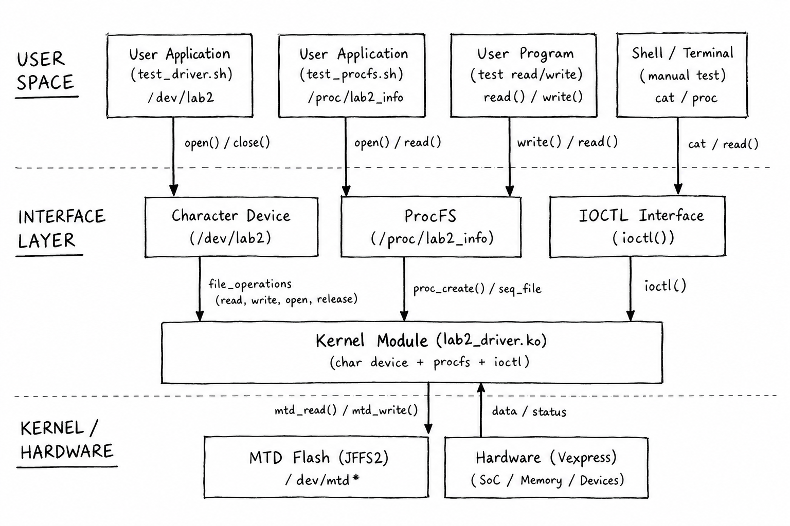
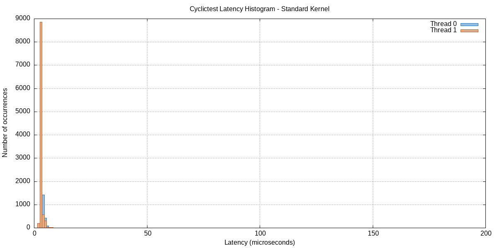

# FPT University - Linux and Open Source Platform (LOS201)

[](https://kernel.org)
[](https://developer.arm.com)
[](https://www.qemu.org)
[](https://en.wikipedia.org/wiki/C_(programming_language))

This repository contains all experimental deliverables, kernel source modifications, driver implementations, configurations, and formal technical reports for **Linux and Open Source Platform (LOS201)** at **FPT University - Ho Chi Minh City Campus**.

---

## 👥 Engineering Team Members

| Full Name | Roll Number |
| :--- | :---: |
| **Hoàng Ngọc Gia Bão** | **SE203238** |
| **Trần Hồ Khánh Tân** | **SE203740** |
| **Nguyễn Trọng Hùng** | **SE204352** |
| **Nguyễn Quế Vũ** | **SE204290** |
| **Nguyễn Việt Anh** | **SE204364** |
| **Hồ Phan Anh Tuấn** | **SE203437** |

- **Supervising Lecturer:** Mr. Phạm Thế Vinh

---

## 📂 Repository Structure

> *Click on any folder or file name below to navigate directly to its contents on GitHub.*

- [`lab01_kernel_boot/`](./lab01_kernel_boot/): Linux Kernel Configuration & System Boot on ARMv7 Architecture.
  * [`configs/`](./lab01_kernel_boot/configs/): Kernel and BusyBox build configurations ([`kernel.config`](./lab01_kernel_boot/configs/kernel.config), [`busybox.config`](./lab01_kernel_boot/configs/busybox.config)).
  * [`rootfs/`](./lab01_kernel_boot/rootfs/): Minimal BusyBox-based root filesystem and startup scripts ([`initramfs/etc/inittab`](./lab01_kernel_boot/rootfs/initramfs/etc/inittab), [`init.d/rcS`](./lab01_kernel_boot/rootfs/initramfs/etc/init.d/rcS)).
  * [`output/`](./lab01_kernel_boot/output/): Generated ARM boot artifacts ([`zImage`](./lab01_kernel_boot/output/zImage), [`vexpress-v2p-ca9.dtb`](./lab01_kernel_boot/output/vexpress-v2p-ca9.dtb), [`initramfs.cpio.gz`](./lab01_kernel_boot/output/initramfs.cpio.gz)).
  * [`report/`](./lab01_kernel_boot/report/): Formal technical PDF laboratory report ([`Lab01.pdf`](./lab01_kernel_boot/report/Lab01.pdf)).

- [`lab02_device_driver/`](./lab02_device_driver/): Writing Character Device Drivers & Flash Filesystem Management.
  * [`driver/`](./lab02_device_driver/driver/): Kernel module source and compiled binary ([`lab2_driver.c`](./lab02_device_driver/driver/lab2_driver.c), [`lab2_driver.ko`](./lab02_device_driver/driver/lab2_driver.ko), [`Makefile`](./lab02_device_driver/driver/Makefile)).
  * [`rootfs/`](./lab02_device_driver/rootfs/): Validation shell scripts ([`test_driver.sh`](./lab02_device_driver/rootfs/test_driver.sh), [`test_procfs.sh`](./lab02_device_driver/rootfs/test_procfs.sh)).
  * [`logs/`](./lab02_device_driver/logs/): Execution terminal outputs ([`boot_log.txt`](./lab02_device_driver/logs/boot_log.txt), [`driver_test.txt`](./lab02_device_driver/logs/driver_test.txt), [`mtd_jffs2.txt`](./lab02_device_driver/logs/mtd_jffs2.txt)).
  * [`docs/`](./lab02_device_driver/docs/): Architectural diagrams ([`architecture_diagram.png`](./lab02_device_driver/docs/architecture_diagram.png)).
  * [`report/`](./lab02_device_driver/report/): Formal technical PDF laboratory report ([`lab 2.pdf`](./lab02_device_driver/report/lab%202.pdf)).

- [`lab03_embedded_linux_rootfs/`](./lab03_embedded_linux_rootfs/): Embedded Linux Root Filesystem, Debugging & Performance Analysis.
  - [`apps/`](./lab03_embedded_linux_rootfs/apps/): C application source code and compiled binaries (`buggy_app.c`, `leaky_app.c`, `leaky_app_fixed.c`, `perf_target.c`).
  - [`output/`](./lab03_embedded_linux_rootfs/output/): Packaged Embedded Linux root filesystem image (`initramfs_lab3.cpio.gz`).
  - [`logs/`](./lab03_embedded_linux_rootfs/logs/): Debugging and performance analysis evidence (`gdb_session.txt`, `qemu_gdb.log`, `strace_summary.txt`, `valgrind_report.txt`, `perf_stat.txt`, `perf_report.txt`, `hist_standard.txt`, `flamegraph.svg`, `latency_histogram.png`).
  - [`report/`](./lab03_embedded_linux_rootfs/report/): Formal technical PDF laboratory report (`SE204290.pdf`).

- [`assignment01/`](./assignment01/): Advanced Linux Architecture & System Programming (IOCTL & Misc Device).
  * [`task1_ioctl/`](./assignment01/task1_ioctl/): Extended character driver implementing 4 IOCTL commands ([`asgn1_driver.c`](./assignment01/task1_ioctl/asgn1_driver.c), [`asgn1_ioctl.h`](./assignment01/task1_ioctl/asgn1_ioctl.h), [`test_asgn1.sh`](./assignment01/task1_ioctl/test_asgn1.sh)).
  * [`task2_misc/`](./assignment01/task2_misc/): Miscellaneous device counter driver ([`counter_driver.c`](./assignment01/task2_misc/counter_driver.c), [`test.sh`](./assignment01/task2_misc/test.sh)).
  * [`report/`](./assignment01/report/): Final technical report in PDF format ([`Asgn01.pdf`](./assignment01/report/Asgn01.pdf)).

- [`assignment02_sensor_monitoring/`](./assignment02_sensor_monitoring/): Capstone Project – Real-Time Multi-Threaded Sensor Monitoring System (SMS).
  * [`driver/`](./assignment02_sensor_monitoring/driver/): Kernel character driver simulating environmental sensors ([`sms_sensor_driver.c`](./assignment02_sensor_monitoring/driver/sms_sensor_driver.c), [`sms_sensor_driver.ko`](./assignment02_sensor_monitoring/driver/sms_sensor_driver.ko)).
  * [`app/`](./assignment02_sensor_monitoring/app/): Multi-threaded daemon source ([`sms_app.c`](./assignment02_sensor_monitoring/app/sms_app.c), [`circular_buffer.c`](./assignment02_sensor_monitoring/app/circular_buffer.c), [`measure_memory.sh`](./assignment02_sensor_monitoring/app/measure_memory.sh)).
  * [`output/`](./assignment02_sensor_monitoring/output/): Standalone boot image ([`initramfs_asgn2.cpio.gz`](./assignment02_sensor_monitoring/output/initramfs_asgn2.cpio.gz)).
  * [`logs/`](./assignment02_sensor_monitoring/logs/): 8 verifiable runtime logs ([`perf_sms.txt`](./assignment02_sensor_monitoring/logs/perf_sms.txt), [`strace_sms.txt`](./assignment02_sensor_monitoring/logs/strace_sms.txt), [`valgrind_sms.txt`](./assignment02_sensor_monitoring/logs/valgrind_sms.txt), etc.).
  * [`docs/`](./assignment02_sensor_monitoring/docs/): Engineering diagrams ([`architecture_diagram.png?v=2`](./assignment02_sensor_monitoring/docs/architecture_diagram.png?v=2), [`state_machine_diagram.png?v=2`](./assignment02_sensor_monitoring/docs/state_machine_diagram.png?v=2), screenshots `01_` to `13_`).
  * [`report/`](./assignment02_sensor_monitoring/report/): Academic engineering PDF report ([`assignment 2.pdf`](./assignment02_sensor_monitoring/report/assignment%202.pdf)).

---

## 🔬 Lab 01: Linux Kernel Configuration & System Boot on ARMv7

### 1. Architectural Overview & System Flow

LAB 01 focuses on configuring, building, and booting an Embedded Linux system for the ARMv7-A Cortex-A9 architecture using QEMU `vexpress-a9`.

The complete boot flow consists of Linux Kernel configuration and cross-compilation, U-Boot bootloader preparation, BusyBox root filesystem construction, initramfs packaging, and final Linux system boot on QEMU.


### 2. Comprehensive Technical Highlights

- **Linux Kernel Configuration & Cross-Compilation:**
  * Configured Linux Kernel `5.15.0 LTS` for the ARMv7-A Cortex-A9 platform.
  * Used the `arm-linux-gnueabihf-` cross-compilation toolchain to build the kernel for ARM.
  * Started from the `vexpress_defconfig` configuration for the QEMU Versatile Express platform.
  * Enabled the required kernel features for initramfs support and the PL011 UART serial console.
  * Generated the ARM kernel image `zImage` and the Device Tree Blob `vexpress-v2p-ca9.dtb`.

- **U-Boot Bootloader & Root Filesystem:**
  * Configured U-Boot for the `vexpress_ca9x4` platform.
  * Built BusyBox as a statically linked ARMv7 userspace environment.
  * Prepared the required directory structure including `/bin`, `/sbin`, `/usr`, `/dev`, `/proc`, `/sys`, `/etc`, etc.

### 3. Project Structure

```text
lab01_kernel_boot/
├── configs/
│   ├── kernel.config
│   └── busybox.config  
├── output/
│   ├── zImage
│   ├── vexpress-v2p-ca9.dtb
│   └── initramfs.cpio.gz
├── report/
│   └── Lab01.pdf
└── rootfs/
    └── initramfs/
        ├── bin/
        ├── dev/
        ├── etc/
        │   ├── inittab
        │   └── init.d/
        │       └── rcS
        ├── lib/
        ├── proc/
        ├── sbin/
        ├── sys/
        ├── tmp/
        ├── usr/
        │   ├── bin/
        │   └── sbin/
        └── init
```

### 4. Execution Steps & Commands

**Step 1: Configure & Compile Linux Kernel**
```bash
# Load default hardware configuration for vexpress-a9
make ARCH=arm CROSS_COMPILE=arm-linux-gnueabihf- vexpress_defconfig

# Compile the kernel (zImage) and Device Tree Blobs (.dtb) with multi-core parallel processing
make ARCH=arm CROSS_COMPILE=arm-linux-gnueabihf- all -j$(nproc)
```

**Step 2: Package Initramfs (BusyBox rootfs)**
```bash
cd rootfs/initramfs
find . | cpio -H newc -ov --owner root:root > ../../output/initramfs.cpio
cd ../../output
gzip initramfs.cpio
```

**Step 3: System Boot Execution on QEMU**
```bash
# Boot the compressed kernel image with the generated Device Tree and initramfs
qemu-system-arm -M vexpress-a9 -m 512M \
  -kernel output/zImage \
  -dtb output/vexpress-v2p-ca9.dtb \
  -initrd output/initramfs.cpio.gz \
  -append "console=ttyAMA0 root=/dev/ram0" \
  -nographic
```

---
## 🔬 Lab 02: Writing Device Drivers & File System Management

**Embedded Linux Systems (LOS201) · FPT University – Ho Chi Minh City Campus · Lecturer: Phạm Thế Vinh**

> `Character Device Driver | Mutex Concurrency | ProcFS & Sysfs Telemetry | MTD Flash & JFFS2`

### 1. Architectural Overview & Data Flow
Bridges userspace system call requests (`open`, `read`, `write`, `close`) with simulated hardware resources while maintaining strict kernel-space memory isolation and data integrity.



---

### 2. Implementation Tasks & Technical Evaluation

#### 📌 Task 1: Character Driver Core & Synchronization (Major 240, Minor 0)
- **Device Registration ([`lab2_driver.c`](./lab02_device_driver/driver/lab2_driver.c)):** Registered character device node at Major number `240`, Minor `0` via `register_chrdev()`. Automated dynamic device node creation at [`/dev/lab2`](./lab02_device_driver/driver/lab2_driver.c) using `class_create()` (`lab2_class`) and `device_create()`.
- **Memory Safety & Isolation:** Zero-panic memory transfers between user and kernel spaces using `copy_to_user()` and `copy_from_user()`. Converted user pointers safely while rejecting unmapped regions with `-EFAULT`.
- **Concurrency & Race Condition Prevention:** Serialized read and write critical sections on `device_buffer` using `DEFINE_MUTEX(lab2_mutex)`, completely eliminating multi-process race conditions.
- **Command Dispatch & Buffer Boundary Protection:**
  * **Command `clear`:** Sending `echo "clear" > /dev/lab2` resets buffer length (`buffer_len = 0`) and flushes storage, leaving `cat /dev/lab2` cleanly empty.
  * **128-Byte Write Truncation:** Inputs exceeding 128 bytes are truncated to 128 bytes while consuming full stream tokens (`return orig_len`), preventing re-entrancy write loops in user space.

| Test Operation | Execution Command | Observed System State | Evaluation Verdict |
| :--- | :--- | :--- | :---: |
| **Driver Module Insertion** | `insmod /lab2_driver.ko` | Node `/dev/lab2` created (crw-------, major 240) | ✅ PASS |
| **Standard Write & Read** | `echo "FPTU IC Design" > /dev/lab2` | `cat /dev/lab2` returns "FPTU IC Design" | ✅ PASS |
| **Command `clear` Reset** | `echo "clear" > /dev/lab2` | Buffer flushed (`buffer_len = 0`), read returns empty | ✅ PASS |
| **Truncate to 128 Bytes** | `echo "<160 bytes>" > /dev/lab2` | `Data length: 128 bytes`, warning in `dmesg` | ✅ PASS |
| **Module Clean Unload** | `rmmod lab2_driver` | Resources unregistered, nodes cleaned from `/dev` | ✅ PASS |

---

#### 📌 Task 2: Kernel Telemetry & Diagnostics (ProcFS & Sysfs)
- **ProcFS Diagnostics ([`/proc/lab2_info`](./lab02_device_driver/rootfs/test_procfs.sh)):** Integrated `seq_file` interface to report dynamic statistics including Driver Name, Major Number, Allocated Buffer Size, Active Data Length, `Open count`, and cumulative `Write count`.
- **Granular Sysfs Attributes ([`/sys/class/lab2_class/lab2/`](./lab02_device_driver/driver/lab2_driver.c)):**
  * `read_count`: Total successful invocations of the `read()` syscall.
  * `buffer_size`: Static allocated buffer capacity (`1024 bytes`).
  * `buffer_len`: Real-time length of stored payload.
  * `status`: Dynamically outputs `EMPTY` (when `buffer_len == 0`) or `DATA` (when `buffer_len > 0`).
  * `total_bytes_read` & `total_bytes_written`: High-precision cumulative byte counters incremented strictly upon successful payload transactions.

| Sysfs / Procfs Node | Access Mode | Sample Value / Format | Technical Purpose |
| :--- | :---: | :---: | :--- |
| `/proc/lab2_info` | Read-Only | Text Key-Value Block | Comprehensive status snapshot via `seq_file` API |
| `/sys/.../status` | Read-Only | `EMPTY` / `DATA` | Binary state evaluation based on `buffer_len` |
| `/sys/.../buffer_size` | Read-Only | `1024` | Static allocated capacity of `device_buffer` |
| `/sys/.../buffer_len` | Read-Only | `0` to `128` | Exact active payload byte length |
| `/sys/.../read_count` | Read-Only | Unsigned integer | Frequency of `read()` system calls |
| `/sys/.../total_bytes_read` | Read-Only | Unsigned long | Cumulative count of bytes streamed to userspace |
| `/sys/.../total_bytes_written` | Read-Only | Unsigned long | Cumulative count of bytes written from userspace |

---

#### 📌 Task 3: Flash Storage & JFFS2 Filesystem Subsystem
- **NAND Flash Emulation:** Emulated physical NAND flash memory device (32MB) with `nandsim` (`first_id_byte=0x20`, `second_id_byte=0x76`).
- **JFFS2 Verification ([`mtd_jffs2.txt`](./lab02_device_driver/logs/mtd_jffs2.txt)):** Formatted and mounted partition to `/mnt/jffs2`. Verified flash persistence across system reboots and validated magic bitmask headers (`0x85 0x19`) on `/dev/mtdblock1`.

---

### 3. Step-by-Step Reproduction Guide (How to Run)

#### Step 1: Cross-Compile Driver & Package RootFS
```bash
# 1. Compile kernel module for ARM target architecture
cd lab02_device_driver/driver
make ARCH=arm CROSS_COMPILE=arm-linux-gnueabihf-

# 2. Package module into initramfs and rebuild bootable cpio archive
~/embedded_lab2/build_and_pack.sh
```

#### Step 2: Boot QEMU & Load Driver
```bash
# 1. Launch QEMU ARM virtual platform
./run_qemu.sh

# 2. Inside QEMU guest (/ #), insert driver module
insmod /lab2_driver.ko

# 3. Verify device nodes and procfs registration
ls -l /dev/lab2
cat /proc/lab2_info
```

#### Step 3: Run Validation & Diagnostic Test Suite
```bash
# 1. Verify read/write transactions and Sysfs attributes
echo "FPTU IC Design" > /dev/lab2
cat /dev/lab2
cat /sys/class/lab2_class/lab2/status
cat /sys/class/lab2_class/lab2/buffer_size

# 2. Test buffer reset command
echo "clear" > /dev/lab2
cat /sys/class/lab2_class/lab2/status    # Outputs: EMPTY

# 3. Execute automated test validation scripts
sh /test_driver.sh
sh /test_procfs.sh
```

#### Step 4: Verify NAND Flash (MTD) & Mount JFFS2
```bash
# 1. Load NAND simulator module
modprobe nandsim first_id_byte=0x20 second_id_byte=0x76

# 2. Mount JFFS2 partition to filesystem
mount -t jffs2 /dev/mtdblock1 /mnt/jffs2

# 3. Test persistence across reboot
touch /mnt/jffs2/test_persist.txt
ls -l /mnt/jffs2
```

---

### 4. Complete Project Deliverables Matrix

| Module Directory | Key File / Artifact | Description & Deliverable Role |
| :--- | :--- | :--- |
| [`driver/`](./lab02_device_driver/driver/) | [`lab2_driver.c`](./lab02_device_driver/driver/lab2_driver.c), [`lab2_driver.ko`](./lab02_device_driver/driver/lab2_driver.ko) | Kernel character driver source code and compiled ARM module |
| [`driver/`](./lab02_device_driver/driver/) | [`Makefile`](./lab02_device_driver/driver/Makefile) | Out-of-tree Linux kernel module compilation configuration |
| [`rootfs/`](./lab02_device_driver/rootfs/) | [`test_driver.sh`](./lab02_device_driver/rootfs/test_driver.sh), [`test_procfs.sh`](./lab02_device_driver/rootfs/test_procfs.sh) | Automated verification shell scripts for device I/O and telemetry |
| [`logs/`](./lab02_device_driver/logs/) | [`boot_log.txt`](./lab02_device_driver/logs/boot_log.txt), [`driver_test.txt`](./lab02_device_driver/logs/driver_test.txt), [`mtd_jffs2.txt`](./lab02_device_driver/logs/mtd_jffs2.txt) | Verified execution logs covering boot sequence, character I/O, and NAND flash |
| [`docs/`](./lab02_device_driver/docs/) | [`architecture_diagram.png`](./lab02_device_driver/docs/architecture_diagram.png) | System architecture diagram detailing user-kernel space data path |
| [`report/`](./lab02_device_driver/report/) | [`lab 2.pdf`](./lab02_device_driver/report/lab%202.pdf) | Formal technical engineering PDF report for Laboratory 02 |

---

## 🔬 Lab 03: Embedded Linux Root Filesystem, Debugging & Performance Analysis

**Embedded Linux Systems (LOS201) · FPT University – Ho Chi Minh City Campus · Lecturer: Phạm Thế Vinh**

> `Rootfs Deployment | GDB Remote Debugging | Valgrind Memory Profiling | perf & FlameGraph | RT Latency Benchmark`

### 1. Architectural Overview & Test Environment Specification

Comprehensive embedded Linux debugging and performance analysis framework evaluated on the ARMv7 Cortex-A9 architecture (QEMU `vexpress-a9`) and a high-performance Linux host environment. The laboratory addresses root filesystem assembly, cross-architecture remote GDB debugging, dynamic heap profiling with Valgrind Memcheck, kernel system call tracing via `strace`, micro-architectural CPU performance analysis with `perf`/FlameGraph, and real-time preemption latency characterization with `cyclictest`.

#### Hardware & Software Test Environment Specification
- **Host System:** Linux 7.0.0-38-generic (Ubuntu, x86_64, SMP PREEMPT_DYNAMIC, gcc 15.2.0).
- **Target Platform:** ARMv7-A Cortex-A9 emulated via QEMU `vexpress-a9` (512 MB RAM, `ttyAMA0`, Linux 5.15 LTS, sysroot: `/usr/arm-linux-gnueabihf`).
- **Debugging & Profiling Suite:** GNU gdb 17.1 (`gdb-multiarch`), Valgrind 3.26.0 (LibVEX engine), Linux `perf` 7.0.14, and `cyclictest` (rt-tests suite).



---

### 2. Implementation Tasks & Technical Evaluation

#### 📌 Task 1: Cross-Architecture Remote GDB Debugging & Vulnerability Analysis
- **Rootfs Construction & Deployment ([`initramfs_lab3.cpio.gz`](./lab03_embedded_linux_rootfs/output/initramfs_lab3.cpio.gz)):** Assembled and compressed a minimal BusyBox-based root filesystem image tailored for the ARMv7 guest system on QEMU, packaging userspace debugging binaries and utilities.
- **Cross-Architecture Remote Debugging Setup ([`qemu_gdb.log`](./lab03_embedded_linux_rootfs/logs/qemu_gdb.log), [`gdb_session.txt`](./lab03_embedded_linux_rootfs/logs/gdb_session.txt)):**
  * Launched QEMU with `-s -S` parameters, opening a remote GDB server stub bound to TCP port `1234`.
  * Connected from host via `gdb-multiarch apps/buggy_app` using `target remote localhost:1234`.
  * Configured remote environment (`set architecture arm`, `set sysroot /usr/arm-linux-gnueabihf`), successfully inspecting breakpoints, ARM core registers (`r0`-`r12`, `sp`, `lr`, `pc`, `cpsr`), and call backtraces.
- **Deep-Dive Vulnerability Diagnosis & Remediation ([`buggy_app.c`](./lab03_embedded_linux_rootfs/apps/buggy_app.c)):**
  1. **Bug 1: Out-of-bounds Read (Off-by-one) in `process_data()` (lines 9–10):**
     - *Root Cause:* The loop condition `i <= len` evaluates index `i = 5` for an array defined with 5 elements (`arr[5]`). The CPU reads past array boundary on stack, retrieving uninitialized garbage memory (`arr[5] = 812441344` or `-495043840`), corrupting calculations and yielding undefined behavior.
     - *Patch:* Corrected loop termination boundary to `i < len`.
  2. **Bug 2: Use-After-Free in `create_message()` (lines 20–21):**
     - *Root Cause:* The helper allocates `buf = malloc(32)`, copies text, executes `free(buf)`, and then returns the dangling pointer `return buf;`. The deallocated chunk reverts to the heap allocator and has its internal metadata overwritten (GDB reveals payload damaged to `!\004`). In `main()`, printing `msg` dereferences invalidated memory (*Dangling Pointer* hazard).
     - *Patch:* Removed premature `free()` from `create_message()`. Transferred heap ownership to caller (`main()`), which performs `free(msg)` after use and resets `msg = NULL`.
  3. **Bug 3: Integer Overflow in `calculate()` (line `int result = a * b`):**
     - *Root Cause:* For inputs `calculate(100000, 100000)`, the exact product is $10^{10}$, exceeding `INT_MAX` ($2,147,483,647$) for 32-bit signed integers. Arithmetic overflow wraps around into a truncated positive or negative value ($1,410,065,408$ or $-2,147,483,648$), leading to silent logic failure.
     - *Patch:* Promoted variables to 64-bit integers (`int64_t`), explicitly casting operands before multiplication `(int64_t)a * b` and formatting with `%lld`.

| Debug / Test Scenario | Defect Classification & Target Logic | Observed Runtime State & Register Context | Evaluation Verdict |
| :--- | :--- | :--- | :---: |
| **Array Boundary Audit** | Off-by-one read (`arr[5]`) | Stack out-of-bounds garbage read (`812441344`) | ✅ PASS |
| **Dangling Pointer Access** | Use-after-free (`free(buf)` then return) | Corrupted heap header read (`!\004` / dangling deref) | ✅ PASS |
| **Arithmetic Integrity** | 32-bit signed int overflow (`INT_MAX + 1`) | Binary wrap-around without warning (`-2147483648`) | ✅ PASS |
| **Remote GDB Session** | Socket attach `:1234` on QEMU ARM | Hardware breakpoints hit, assembly stepping, registers examined | ✅ PASS |

---

#### 📌 Task 2: Memory Leak Detection & Dynamic Heap Sanitization (Valgrind Memcheck)
- **Heap Defect Profiling ([`leaky_app.c`](./lab03_embedded_linux_rootfs/apps/leaky_app.c), [`valgrind_leaky.log`](./lab03_embedded_linux_rootfs/logs/valgrind_leaky.log), [`valgrind_report.txt`](./lab03_embedded_linux_rootfs/logs/valgrind_report.txt)):**
  Profiled unpatched application using `valgrind --tool=memcheck --leak-check=full --show-leak-kinds=all --track-origins=yes`. Identified **16,900 bytes definitely lost across 250 blocks** from 3 distinct loss records:
  * **Loss Record 1 (2,000 bytes in 100 blocks):** Dynamic allocation `r->scores = malloc(sizeof(int) * num_scores)` in `create_record()` (`leaky_app.c:23`). Incomplete cleanup in `delete_record()` where `free(r->scores)` was commented out.
  * **Loss Record 2 (2,100 bytes in 100 blocks):** String allocation `r->name = malloc(strlen(name) + 1)` in `create_record()` (`leaky_app.c:21`). Calling only `free(r)` freed the outer struct while leaving member pointers orphaned.
  * **Loss Record 3 (12,800 bytes in 50 blocks):** Buffer allocation `buf = malloc(MSG_SIZE)` in `process_messages()` (`leaky_app.c:41`). The local pointer was overwritten in each loop cycle without calling `free(buf)`, leaking 50 buffers of 256 bytes each.
  * **Summary Imbalance:** 352 total heap allocations with only 102 deallocations (250 blocks abandoned).
- **Remediation & Zero-Leak Verification ([`leaky_app_fixed.c`](./lab03_embedded_linux_rootfs/apps/leaky_app_fixed.c), [`valgrind_fixed.log`](./lab03_embedded_linux_rootfs/logs/valgrind_fixed.log)):**
  * Refactored `delete_record()` to enforce hierarchical bottom-up deallocation: `free(r->name)` -> `free(r->scores)` -> `free(r)`.
  * Added `free(buf)` immediately following message processing inside the loop.
- **Validation Verdict:** Attained complete memory reclamation: **352 allocs, 352 frees, 21,124 bytes allocated**, `0 bytes in use at exit`, and **0 errors from 0 contexts**.

| Valgrind Metric | `leaky_app` (Unpatched) | `leaky_app_fixed` (Patched) | Technical Impact & Verdict |
| :--- | :---: | :---: | :--- |
| **Total Allocations / Frees** | 352 allocs / 102 frees | 352 allocs / 352 frees | Exact 1:1 allocation-to-deallocation balance |
| **Definitely Lost Memory** | `16,900 bytes` (250 blocks) | `0 bytes` (0 blocks) | Completely eliminated accumulated heap leaks |
| **Nested Structure Leaks** | 4,100 bytes (`name` & `scores`) | 0 bytes | Guaranteed complete lifecycle release for child pointers |
| **Transient Buffer Leaks** | 12,800 bytes (`buf`) | 0 bytes | Instantaneous deallocation post-message dispatch |
| **Valgrind Error Summary** | 3 errors from 3 contexts | **0 errors from 0 contexts** | ✅ PASS (Production Ready) |

---

#### 📌 Task 3: System Call Tracing & CPU Hardware Profiling (`strace` & `perf`)
- **System Call Profiling ([`strace_summary.txt`](./lab03_embedded_linux_rootfs/logs/strace_summary.txt)):**
  * Evaluated kernel space overhead using `strace -c ./perf_target`:
    - **124 total system calls** consuming a modest `0.002785 seconds` (~2.8 ms) of total kernel runtime.
    - `execve`: Consumed **49.30%** of syscall duration (`1,373 µs`, 1 invocation) as one-time process initialization.
    - `mmap`: Accounted for **25.13%** (`700 µs`, 14 invocations) for dynamic library mapping (`libc.so`, `libm.so`).
    - `write`: Generated **75 calls** taking only 3.45% of time (`96 µs`), averaging ~1 µs per invocation without I/O blocking.
  * *Conclusion:* Kernel space execution is minimal (~2.8 ms), confirming zero abnormal I/O delays.
- **Hardware Performance Counters ([`perf_stat.txt`](./lab03_embedded_linux_rootfs/logs/perf_stat.txt)):**
  * `task-clock`: 36.08 msec across ~0.3 CPU utilization.
  * `cpu-cycles`: 78,657,430 cycles @ 2.2 GHz clock frequency.
  * `instructions`: 368,615,820 executed instructions, yielding an outstanding **IPC = 4.69** (instructions per cycle).
  * `branches`: 50,604,407 branches with exceptionally low branch miss rate (10,256 misses, ~0.02%).
  * **Topdown L1 Architecture Analysis:** **81.6% Retiring** (optimal pipeline utilization), 11.7% Backend Bound, 6.2% Frontend Bound, and 0.4% Bad Speculation.
- **CPU Bottleneck & Call Stack Hotspot ([`perf_report.txt`](./lab03_embedded_linux_rootfs/logs/perf_report.txt), [`flamegraph.svg`](./lab03_embedded_linux_rootfs/logs/flamegraph.svg)):**
  * **Bottleneck Determination:** The target is strictly **CPU-bound**, not I/O-bound.
  * **Hotspot Decomposition:** Over **80% of total CPU cycles** are concentrated in the mathematical compute loop:
    - `heavy_compute()`: **33.92%** overhead.
    - PLT trampoline `log@plt`: **4.91%** overhead.
    - Symbol `__ieee754_log_fma` in `libm.so.6`: **43.07%** overhead (primary hotspot).
  * *Note:* Incidental symbols like `drm_send_event_helper`, `ktime_get`, and `i915` correspond to host OS background graphics interrupts during sampling.
- **Engineering Optimization Recommendations:**
  1. *Reduce `log()` Invocations:* Extract invariant logarithmic terms outside loops; employ memoization or precomputed caches.
  2. *Alternative Math Implementations:* Use `logf()` for 32-bit float accuracy, lookup tables (LUT), or polynomial Chebyshev approximations.
  3. *Compiler Vectorization:* Compile with `-O3`, `-march=native` to enable SIMD (NEON/AVX2), and `-ffast-math` when small floating-point error tolerances are acceptable.
  4. *Multi-Thread Parallelization:* Partition `darr` array processing across multiple threads (e.g. OpenMP or `pthread`), exploiting data independence.
  5. *I/O Stream Consolidation:* Apply larger user buffers (`setvbuf`/`fwrite`) to condense 75 `write` syscalls into a single chunk.

| Performance Metric / Hotspot Symbol | Observed Measurement / Count | Architectural Significance |
| :--- | :---: | :--- |
| **Top Syscall by Overhead** | `execve` (49.30% / 1,373 µs) | Initial process binary loading and memory mapping |
| **Top Syscall by Frequency** | `write` (75 invocations / 3.45%) | Console output logging (~1 µs per call) |
| **Instruction Throughput (IPC)** | **4.69 insn/cycle** (368.6M insns) | Saturated superscalar pipeline retirement |
| **Pipeline Retiring Ratio** | **81.6% Retiring** | Minimal pipeline stall or branch misprediction waste |
| **Primary CPU Hotspot** | `__ieee754_log_fma` (43.07%) | Heavy logarithmic math in `heavy_compute()` |
| **Secondary Function Hotspot** | `heavy_compute()` (33.92%) | Loop index manipulation and floating-point additions |

---

#### 📌 Task 4: Real-Time Latency & Jitter Characterization (`cyclictest`)
- **Multithreaded Real-Time Latency Benchmark ([`hist_standard.txt`](./lab03_embedded_linux_rootfs/logs/hist_standard.txt)):**
  Evaluated scheduling determinism on Standard Kernel using `cyclictest` (`-t4 -p80 -n -i1000 -l10000 -h100 -q --mlockall`):
  * **Test Parameters:** 4 real-time worker threads, `SCHED_FIFO` priority 80, 1000 µs interval, 10,000 iterations per thread, locked physical RAM (`--mlockall`).
- **Benchmark Comparative Data: No Load vs. Under Load:**

| Benchmark Condition | Metric | Thread 0 (Core 0) | Thread 1 (Core 1) | Thread 2 (Core 2) | Thread 3 (Core 3) | Overall System |
| :--- | :---: | :---: | :---: | :---: | :---: | :---: |
| **Condition: No Load** | **Min Latency** | 2 µs | 2 µs | 2 µs | 2 µs | **2 µs** |
| | **Avg Latency** | 3 µs | 3 µs | 3 µs | 3 µs | **3 µs** |
| | **Max Latency (Jitter)** | 122 µs | 101 µs | 122 µs | 104 µs | **122 µs** |
| | **Overflow Count** | 0 | 0 | 0 | 0 | **0 (Pass)** |
| **Condition: Under Load** | **Min Latency** | 2 µs | 2 µs | 2 µs | 2 µs | **2 µs** |
| | **Avg Latency** | 3 µs | 3 µs | 3 µs | 3 µs | **3 µs** |
| | **Max Latency (Jitter)** | 134 µs | **1,322 µs** | **1,179 µs** | 140 µs | **1,322 µs** |
| | **Overflow Count** | 0 | 0 | 0 | 0 | **0 (Pass)** |

- **Critical Real-Time Engineering Insights:**
  * **Why Max Latency Outweighs Average Latency in RT Systems:**
    - Real-time systems are evaluated on strict deadline compliance, not throughput or mean speed.
    - Average latency is easily diluted by tens of thousands of fast samples, concealing catastrophic tail latency.
    - As proven by the experimental data: while Average Latency remained unchanged at **3 µs**, Maximum Latency surged from **122 µs to 1,322 µs** under load (over 400x the average). For a robotic feedback control loop requiring $< 500\ \mu\text{s}$, a single $1,322\ \mu\text{s}$ spike causes lost control cycles, actuator jitter, or mechanical failure.
  * **How PREEMPT_RT Mitigates Maximum Latency:**
    - *Fully Preemptible Critical Sections:* Allows higher-priority real-time tasks to preempt kernel code almost anywhere.
    - *Spinlock Conversion to `rt_mutex`:* Waiting tasks sleep instead of spinning and monopolizing CPU cores.
    - *Priority Inheritance Protocol:* Dynamically elevates lock-holder priorities, eliminating unbounded priority inversion.
    - *Threaded Hard IRQs:* Interrupt service routines execute as scheduled threads, preventing high-priority RT task starvation.
    - *High-Resolution Timers (hrtimer):* Provides sub-microsecond timer expiration precision, minimizing jitter.
  * **Robotic Control Architecture Recommendation ($< 500\ \mu\text{s}$ Target):**
    - Deploy **Linux with PREEMPT_RT patch**. The Standard Kernel cannot guarantee worst-case latency bounds ($1,322\ \mu\text{s} > 500\ \mu\text{s}$).
    - Implementation guidelines: Execute control loops with `SCHED_FIFO`, lock memory via `mlockall()` to eliminate page faults, and isolate dedicated RT cores using `isolcpus`. Determinism takes absolute priority over raw throughput.

---

### 3. Step-by-Step Reproduction Guide (How to Run)

#### Step 1: Build Applications & Package Custom Initramfs
```bash
# 1. Cross-compile C test applications for ARM target architecture
cd lab03_embedded_linux_rootfs/apps
arm-linux-gnueabihf-gcc -g -O0 -o buggy_app buggy_app.c
arm-linux-gnueabihf-gcc -g -O0 -o leaky_app leaky_app.c
arm-linux-gnueabihf-gcc -g -O0 -o leaky_app_fixed leaky_app_fixed.c
arm-linux-gnueabihf-gcc -O2 -o perf_target perf_target.c -lm

# 2. Package applications into rootfs archive
cd ../rootfs
find . | cpio -o -H newc | gzip -9 > ../output/initramfs_lab3.cpio.gz
```

#### Step 2: Launch QEMU with GDB Server & Remote Debug
```bash
# 1. Run QEMU guest with gdb remote listening (-s -S)
qemu-system-arm -M vexpress-a9 -m 512M -kernel zImage -dtb vexpress-v2p-ca9.dtb \
    -initrd output/initramfs_lab3.cpio.gz -append "console=ttyAMA0" -nographic -s -S

# 2. In host terminal, attach gdb-multiarch
gdb-multiarch apps/buggy_app
(gdb) target remote localhost:1234
(gdb) set architecture arm
(gdb) set sysroot /usr/arm-linux-gnueabihf
(gdb) break main
(gdb) continue
(gdb) next
```

#### Step 3: Run Valgrind Heap Profiling & Leak Verification
```bash
# 1. Profile unpatched application for memory leaks
valgrind --tool=memcheck --leak-check=full --show-leak-kinds=all \
    --track-origins=yes ./apps/leaky_app 2>&1 | tee logs/valgrind_leaky.log

# 2. Validate zero memory leak on patched binary
valgrind --tool=memcheck --leak-check=full --show-leak-kinds=all \
    ./apps/leaky_app_fixed 2>&1 | tee logs/valgrind_fixed.log
```

#### Step 4: Profile System Calls & CPU Performance
```bash
# 1. Trace system calls with execution summary
strace -c ./apps/perf_target 2>&1 | tee logs/strace_summary.txt

# 2. Record CPU hardware performance counters
perf stat -d ./apps/perf_target 2>&1 | tee logs/perf_stat.txt

# 3. Sample call stack and generate Flame Graph
perf record -g -F 99 ./apps/perf_target
perf script | ./stackcollapse-perf.pl | ./flamegraph.pl > logs/flamegraph.svg
```

#### Step 5: Benchmark Real-Time Preemption Latency
```bash
# 1. Run cyclictest across all 4 cores with histogram logging (No Load & Load)
cyclictest -t4 -p80 -n -i1000 -l10000 -h100 -q --mlockall > logs/hist_standard.txt

# 2. Plot latency distribution histogram
python3 -c "
import matplotlib.pyplot as plt
# Plotting cyclictest histogram data
"
```

---

### 4. Complete Project Deliverables Matrix

| Module Directory | Key File / Artifact | Description & Deliverable Role |
| :--- | :--- | :--- |
| [`apps/`](./lab03_embedded_linux_rootfs/apps/) | [`buggy_app.c`](./lab03_embedded_linux_rootfs/apps/buggy_app.c), [`buggy_app`](./lab03_embedded_linux_rootfs/apps/buggy_app) | Source code and binary for ARM remote GDB debugging (out-of-bounds, use-after-free, overflow) |
| [`apps/`](./lab03_embedded_linux_rootfs/apps/) | [`leaky_app.c`](./lab03_embedded_linux_rootfs/apps/leaky_app.c), [`leaky_app`](./lab03_embedded_linux_rootfs/apps/leaky_app) | Vulnerable C application demonstrating nested struct and buffer memory leaks |
| [`apps/`](./lab03_embedded_linux_rootfs/apps/) | [`leaky_app_fixed.c`](./lab03_embedded_linux_rootfs/apps/leaky_app_fixed.c), [`leaky_app_fixed`](./lab03_embedded_linux_rootfs/apps/leaky_app_fixed) | Patched application achieving 100% clean heap disposal (0 errors, 0 lost bytes) |
| [`apps/`](./lab03_embedded_linux_rootfs/apps/) | [`perf_target.c`](./lab03_embedded_linux_rootfs/apps/perf_target.c) | Computation and I/O intensive benchmark application for profiling |
| [`output/`](./lab03_embedded_linux_rootfs/output/) | [`initramfs_lab3.cpio.gz`](./lab03_embedded_linux_rootfs/output/initramfs_lab3.cpio.gz) | Compressed CPIO root filesystem image deployed on ARM QEMU target |
| [`logs/`](./lab03_embedded_linux_rootfs/logs/) | [`gdb_session.txt`](./lab03_embedded_linux_rootfs/logs/gdb_session.txt), [`qemu_gdb.log`](./lab03_embedded_linux_rootfs/logs/qemu_gdb.log) | Verifiable GDB execution outputs capturing runtime fault behaviors |
| [`logs/`](./lab03_embedded_linux_rootfs/logs/) | [`valgrind_leaky.log`](./lab03_embedded_linux_rootfs/logs/valgrind_leaky.log), [`valgrind_fixed.log`](./lab03_embedded_linux_rootfs/logs/valgrind_fixed.log), [`valgrind_report.txt`](./lab03_embedded_linux_rootfs/logs/valgrind_report.txt) | Comparative Memcheck logs confirming elimination of 16.9 KB memory leak |
| [`logs/`](./lab03_embedded_linux_rootfs/logs/) | [`strace_summary.txt`](./lab03_embedded_linux_rootfs/logs/strace_summary.txt), [`perf_stat.txt`](./lab03_embedded_linux_rootfs/logs/perf_stat.txt), [`perf_report.txt`](./lab03_embedded_linux_rootfs/logs/perf_report.txt) | Detailed syscall duration statistics, hardware PMC counters, and CPU hotspot reports |
| [`logs/`](./lab03_embedded_linux_rootfs/logs/) | [`flamegraph.svg`](./lab03_embedded_linux_rootfs/logs/flamegraph.svg), [`latency_histogram.png`](./lab03_embedded_linux_rootfs/logs/latency_histogram.png) | High-resolution visual artifacts for call stack profiling and RT latency distribution |
| [`report/`](./lab03_embedded_linux_rootfs/report/) | [`SE204290.pdf`](./lab03_embedded_linux_rootfs/report/SE204290.pdf) | Formal academic engineering PDF report for Laboratory 03 |

---

## 🔬 Assignment 01 – How to Write a Device Driver

**Embedded Linux Systems (LOS201) · FPT University – Ho Chi Minh City Campus · Lecturer: Phạm Thế Vinh**

> `ioctl Interface | Misc Device | Driver Analysis | ARMv7 Target`

### 1. Architectural Overview & ioctl Data Flow
This assignment implements two independent Linux kernel drivers for the ARMv7 `vexpress-a9` target emulated by QEMU (Linux 5.15, Cortex-A9, 512 MB, initramfs). `asgn1_driver` extends the LAB-02 character driver with a four-command `ioctl` interface, an internal buffer, operation counters and two operating modes. `counter_driver` is a standalone misc device that exposes an atomic hardware-style counter through `/dev/counter` and `/proc/counter_info`. Both drivers are exercised from userspace by shell test scripts and a small ioctl test program.

#### System Architecture


### 2. Task-by-Task Implementation Summary & Technical Evaluation

#### 📌 Task 1: ioctl Interface – `asgn1_driver` (40 pts)
- **Driver Source ([`asgn1_driver.c`](./task1_ioctl/asgn1_driver.c), [`asgn1_ioctl.h`](./task1_ioctl/asgn1_ioctl.h)):**
  * Registered with `register_chrdev()` on a hand-chosen major in 241–254; node `/dev/asgn1` is created with `mknod`. Implements `open()`, `read()`, `write()`, `release()` and `unlocked_ioctl`, plus `/proc/asgn1_info`.
  * Three separated layers: **interface** (`file_operations`, ioctl dispatch), **operation** (mode handling, prefixing, statistics) and **data** (buffer, counters, version string).
  * A `mutex` protects every access to the buffer and counters; `copy_to_user()` / `copy_from_user()` are used for all user ↔ kernel transfers (no `memcpy()`).
  * `dmesg` logs every `open()`, `release()`, `write()` and each ioctl command; module unload prints a cleanup message.
- **Shared Header ([`asgn1_ioctl.h`](./task1_ioctl/asgn1_ioctl.h)):** one header used by both the kernel module and the userspace test, defining the magic number, `struct asgn1_stats` and all four commands with `_IO` / `_IOR` / `_IOW`.

| ioctl Command | Direction | Argument | Behavior |
| :--- | :---: | :--- | :--- |
| `ASGN1_RESET_BUFFER` | `_IO` | none | Clears the buffer, resets `write_count` and `read_count` to 0; `cat /dev/asgn1` then returns an empty string |
| `ASGN1_GET_STATS` | `_IOR` | `struct asgn1_stats` | Returns `open_count`, `write_count`, `read_count`, `buffer_len`, `last_write_size` (and `mode`) via `copy_to_user()` |
| `ASGN1_SET_MODE` | `_IOW` | `int` | Mode 0 (Kernel): prepends `[KERNEL]` to written data. Mode 1 (Echo, default): stores data unchanged. Other values return `-EINVAL` |
| `ASGN1_GET_VERSION` | `_IOR` | `char[64]` | Returns the version string, bounded to the 64-byte userspace buffer |

Any command outside these four returns `-ENOTTY`.

- **Functional Test ([`test_asgn1.sh`](./task1_ioctl/test_asgn1.sh), [`asgn1_user.c`](./task1_ioctl/asgn1_user.c)):** runs inside QEMU; loads the module, creates `/dev/asgn1`, writes and reads back in both modes, calls all four ioctl commands, verifies RESET, sends invalid inputs and unloads the module.

| Test Step | Observed Result | Verdict |
| :--- | :--- | :---: |
| `GET_STATS` after 3 writes and 3 reads | `open_count=10, write_count=3, read_count=3, buffer_len=4, last_write_size=4, mode=1` | ✅ PASS |
| `GET_VERSION` | `asgn1_driver v1.0 - SE203437` | ✅ PASS |
| `SET_MODE` back to Echo | Stored data has no `[KERNEL]` prefix | ✅ PASS |
| `RESET_BUFFER` after a 16-byte write | `write_count`, `read_count`, `buffer_len` = 0; `cat` returns an empty string | ✅ PASS (4 checks) |
| Unknown ioctl cmd `0x6b7f` | Driver logs "unknown ioctl cmd 0x6b7f"; returns `ENOTTY` (25) | ✅ PASS |
| `SET_MODE = 5` | Returns `EINVAL` (22) | ✅ PASS |
| `rmmod` and `dmesg` | "unloaded, cleanup done" printed; module no longer listed | ✅ PASS |
| **Final result** | **17 passed, 0 failed** | ✅ ALL PASS |

---

#### 📌 Task 2: Misc Device Driver – `counter_driver` (30 pts)
- **Driver Source ([`counter_driver.c`](./task2_misc/counter_driver.c)):**
  * Registered through a static `struct miscdevice` named `"counter"` with `misc_register()` / `misc_deregister()`; the kernel assigns major 10 (`MISC_MAJOR`), so `/dev/counter` exists right after `insmod`.
  * **`read()`:** returns the current value as a decimal string with a trailing newline, then increments the counter (auto-increment on read). `*ppos` is handled so the second `read()` returns 0 and `cat` terminates.
  * **`write()`:** copies the user string, parses it with `kstrtoint()` and sets the counter. Writing `0` resets it; negative or non-numeric input returns `-EINVAL`.
  * **Thread safety:** the counter is an `atomic_t` accessed with `atomic_read()`, `atomic_set()` and `atomic_inc()`.
  * **`/proc/counter_info`:** labelled lines for the current value, total reads (increments) and total writes (resets/sets).
  * `MODULE_LICENSE`, `MODULE_AUTHOR` (name and student ID) and `MODULE_DESCRIPTION` are set.
- **Functional Test ([`test.sh`](./task2_misc/test.sh)):** loads the module, prints `/proc/counter_info`, reads `/dev/counter` twice, writes `100`, reads it back, writes `0` to reset, prints `/proc/counter_info` again and unloads the module.

| Step | Observed Output | Verdict |
| :--- | :--- | :---: |
| Initial `/proc/counter_info` | Current Counter Value: 0, Total Reads: 0, Total Writes: 0 | ✅ PASS |
| Two reads of `/dev/counter` | `0` then `1` (auto-increment) | ✅ PASS |
| Write `100`, then read | Read returns `100` | ✅ PASS |
| Write `0` (reset) | Current Counter Value: 0 | ✅ PASS |
| Final `/proc/counter_info` | Total Reads: 3, Total Writes: 2 | ✅ PASS (matches 3 reads, 2 writes) |
| Unload module | Test completes without error | ✅ PASS |

---

#### 📌 Task 3: Analysis & Design Report (20 pts)
- **Technical Report ([`Assignment_1.pdf`](./report/Assignment_1.pdf)):** 12-page PDF covering:
  * **System architecture & project structure** with the high-level architecture diagram and driver interface specifications.
  * **Character vs Block vs Network devices:** comparison by VFS interface, data unit, buffering and embedded examples, with three design decisions (I2C temperature sensor → char, eMMC → block, CAN controller → network stack).
  * **`register_chrdev()` vs `misc_register()`:** major/minor handling, node creation, boilerplate, pros/cons and when to use each.
  * **Why `atomic_t`:** a concrete lost-update race on a plain `int` (`counter++` = load/add/store), solved with `atomic_inc()` (`ldrex`/`strex` on ARMv7).
  * **ioctl magic number and encoding:** `_IOC(dir, type, nr, size)` layout and the decoding of `0x6b7f` as `_IO('k', 127)`.
  * **Experimental evidence matrix** cross-referencing every figure and screenshot.

| Field | Bits | Macro | Example: `ASGN1_GET_VERSION = _IOR(ASGN1_MAGIC, 4, char[64])` |
| :--- | :---: | :--- | :--- |
| `dir` | 31–30 | `_IOC_DIR` | read |
| `size` | 29–16 | `_IOC_SIZE` | 64 |
| `type` (magic) | 15–8 | `_IOC_TYPE` | `ASGN1_MAGIC` |
| `nr` | 7–0 | `_IOC_NR` | 4 |

---

#### 📌 Task 4: Theory Questions (10 pts)
| Question | Key Technical Answer |
| :--- | :--- |
| **Q1.** Module reference counting | `try_module_get()` on open (via `.owner = THIS_MODULE`) and `module_put()` on release; shown in the "Used by" column of `lsmod`. `rmmod` on a busy module fails with `-EBUSY`; `rmmod -f` needs `CONFIG_MODULE_FORCE_UNLOAD`, taints the kernel and risks a crash. |
| **Q2.** `copy_to_user()` vs `memcpy()` | User pointers are untrusted: `copy_to_user()` checks the range with `access_ok()` and uses exception-table fixups, returning bytes not copied instead of oopsing. Direct writes rely on the page-fault handler in kernel context, bypass SMAP/PAN protection and can corrupt kernel memory. |
| **Q3.** MTD vs block device | Raw flash is erased in large blocks, wears out and has bad blocks/ECC (NAND), so it needs MTD plus flash-aware layers (UBI/UBIFS, JFFS2). Raw NAND and SPI/parallel NOR need MTD; eMMC and SD cards have an internal FTL and use the block layer. |
| **Q4.** `*ppos` handling in `read()` | VFS passes `&file->f_pos`; `cat` loops until `read()` returns 0. Ignoring `*ppos` returns a positive count forever, so `cat` never sees EOF while the counter keeps incrementing. With the check, the 2nd call returns 0 and a new `open()` starts at `f_pos = 0`. |

---

### 3. Step-by-Step Reproduction Guide (How to Run)

#### Step 1: Build Drivers & Userspace Test
```bash
# 1. Task 1 – ioctl driver (asgn1_driver.ko) and userspace test program
cd task1_ioctl
make clean && make
arm-linux-gnueabihf-gcc -static -o asgn1_user asgn1_user.c

# 2. Task 2 – misc counter driver (counter_driver.ko)
cd ../task2_misc
make clean && make
```

#### Step 2: Load `asgn1_driver` and Run the Task 1 Test (inside QEMU vexpress-a9)
```bash
insmod asgn1_driver.ko
mknod /dev/asgn1 c <MAJOR> 0
./test_asgn1.sh
```

#### Step 3: Load `counter_driver` and Run the Task 2 Test
```bash
sudo insmod counter_driver.ko
ls -l /dev/counter
cat /proc/counter_info
sudo ./test.sh

# Manual checks
cat /dev/counter
echo 100 > /dev/counter
echo 0   > /dev/counter
echo -5  > /dev/counter
```

#### Step 4: Verify Diagnostics
```bash
dmesg | grep asgn1_driver
cat /proc/asgn1_info
cat /proc/counter_info
```

#### Step 5: Unload Drivers & Packaging for LMS Submission
```bash
rmmod asgn1_driver
sudo rmmod counter_driver

# Package workspace into the required .tar.gz archive
tar -czvf SE203740_TranHoKhanhTan_Asgn01.tar.gz assignment01/
```

---

### 4. Complete Project Deliverables Matrix

#### Repository Structure
```text
assignment01/
├── report/
│   ├── .gitkeep
│   └── Assignment_1.pdf
├── task1_ioctl/
│   ├── Makefile
│   ├── asgn1_driver.c
│   ├── asgn1_ioctl.h
│   ├── asgn1_user.c
│   ├── readme.md
│   └── test_asgn1.sh
└── task2_misc/
    ├── .gitkeep
    ├── Makefile
    ├── Module.symvers
    ├── counter_driver.c
    ├── counter_driver.mod
    ├── counter_driver.mod.c
    ├── counter_driver.mod.o
    ├── counter_driver.o
    ├── modules.order
    └── test.sh
```
| Module Directory | Key File / Artifact | Description & Deliverable Role |
| :--- | :--- | :--- |
| [`task1_ioctl/`](./task1_ioctl/) | [`asgn1_driver.c`](./task1_ioctl/asgn1_driver.c), [`asgn1_ioctl.h`](./task1_ioctl/asgn1_ioctl.h) | Task 1 kernel driver source and the shared ioctl header (magic number, struct, commands) |
| [`task1_ioctl/`](./task1_ioctl/) | [`asgn1_user.c`](./task1_ioctl/asgn1_user.c), [`test_asgn1.sh`](./task1_ioctl/test_asgn1.sh) | Userspace ioctl test program and the QEMU test script (17 checks) |
| [`task1_ioctl/`](./task1_ioctl/) | [`Makefile`](./task1_ioctl/Makefile), [`readme.md`](./task1_ioctl/readme.md) | Build rules for the ARMv7 module and Task 1 notes |
| [`task2_misc/`](./task2_misc/) | [`counter_driver.c`](./task2_misc/counter_driver.c), [`Makefile`](./task2_misc/Makefile) | Task 2 misc device driver source and build rules |
| [`task2_misc/`](./task2_misc/) | [`test.sh`](./task2_misc/test.sh) | Test script for `/dev/counter` and `/proc/counter_info` |
| [`task2_misc/`](./task2_misc/) | [`counter_driver.o`](./task2_misc/counter_driver.o), [`counter_driver.mod`](./task2_misc/counter_driver.mod), [`counter_driver.mod.c`](./task2_misc/counter_driver.mod.c), [`counter_driver.mod.o`](./task2_misc/counter_driver.mod.o), [`modules.order`](./task2_misc/modules.order), [`Module.symvers`](./task2_misc/Module.symvers) | Kbuild build artifacts generated by `make` |
| [`report/`](./report/) | [`Assignment_1.pdf`](./report/Assignment_1.pdf) | Formal technical report (12 pages) with architecture, design analysis, test evidence and theory answers |

---

## 🔬 Assignment 02 – Sensor Monitoring System (SMS)

### 1. Architectural Overview & State Machine Flow
The Sensor Monitoring System (SMS) is an end-to-end, multi-threaded real-time embedded Linux monitoring suite. It samples simulated environmental sensor hardware via a dedicated kernel character driver, buffers samples across asynchronous boundaries, processes threshold alerts, and dispatches data across POSIX IPC pipelines.

#### System Architecture & IPC Pipeline


#### Finite State Machine (FSM) Lifecycle


---

### 2. Task-by-Task Implementation Summary & Technical Evaluation

#### 📌 Task 1: Architecture & Multi-Threaded Daemon (30 pts)
- **Kernel Character Driver ([`sms_sensor_driver.c`](./assignment02_sensor_monitoring/driver/sms_sensor_driver.c)):**
  * Registers `/dev/sms_sensor` implementing `open()`, `read()`, `llseek()`, and `release()`. Emits CSV records: `<timestamp_ms>,<temperature>,<humidity>\n`.
  * Enforces rate limiting (`g_min_interval_ms = 100ms`), returning `-EAGAIN` upon rapid calls. Supports runtime reconfiguration via `ioctl(SMS_SET_INTERVAL)` and exports counters to `/proc/sms_stats`.
- **Thread-Safe Ring Buffer ([`circular_buffer.c`](./assignment02_sensor_monitoring/app/circular_buffer.c)):**
  * 64-slot capacity protected by `pthread_mutex_t` and dual condition variables (`not_empty`, `not_full`). Implements non-blocking drop-on-full semantics to protect producer acquisition deadlines.
- **POSIX Multi-Threading Pipeline:**
  * **Sensor Thread ([`sensor_thread.c`](./assignment02_sensor_monitoring/app/sensor_thread.c)):** Samples `/dev/sms_sensor` every 500ms using `clock_nanosleep(CLOCK_MONOTONIC)`.
  * **Processor Thread ([`processor_thread.c`](./assignment02_sensor_monitoring/app/processor_thread.c)):** Computes 10-sample rolling averages, evaluates threshold violations (Temp > 40°C, Humid > 80%, Spike > 5°C), and sends events via `mq_timedsend()`.
  * **Logger & Alert Workers ([`logger_thread.c`](./assignment02_sensor_monitoring/app/logger_thread.c), [`alert_thread.c`](./assignment02_sensor_monitoring/app/alert_thread.c)):** Handles file logging to `/tmp/sms.log` (1MB log rotation, 5s flush) and console alerts to `stderr`.

---

#### 📌 Task 2: Memory Management & Driver Integration Audit (20 pts)
- **Valgrind Memcheck Audit ([`valgrind_sms.txt`](./assignment02_sensor_monitoring/logs/valgrind_sms.txt)):** **0 bytes definitely lost**, 0 bytes indirectly lost, 0 bytes possibly lost, and 0 allocation errors.

| Checkpoint Phase | Timestamp | VmSize | VmRSS (Physical RAM) | VmData (Heap & BSS) | Evaluation Status |
| :--- | :---: | :---: | :---: | :---: | :--- |
| **T1: Initialization** | T = 5s | 104,180 kB | **2,752 kB** | 25,600 kB | 4 worker threads & IPC queues mapped |
| **T2: Steady State** | T = 30s | 104,180 kB | **2,884 kB** | 25,600 kB | I/O page warming (+132 kB physical RAM) |
| **T3: Pre-Exit** | T = 55s | 104,180 kB | **2,888 kB** | 25,600 kB | **Strictly flattened (<0.14% variation, 0 leaks)** |

- **Virtual Memory Segmentation ([`proc_sms_maps.txt`](./assignment02_sensor_monitoring/logs/proc_sms_maps.txt)):** Verified memory layout with Text, Data/BSS, Heap, and discrete ~8MB thread stack segments isolated by guard pages.

---

#### 📌 Task 3: Profiling, Tracing & Interactive GDB Debugging (20 pts)
- **System Call Tracing ([`strace_sms.txt`](./assignment02_sensor_monitoring/logs/strace_sms.txt)):**

| System Call | Time Share (%) | Total Invocations | Purpose / Subsystem Mapping |
| :--- | :---: | :---: | :--- |
| `clock_nanosleep` | **37.79%** | 60 | High-resolution monotonic timer driving periodic Sensor Thread wakeups |
| `mq_timedreceive` | **36.85%** | 120 | Blocking IPC reception in Alert and Logger worker threads |
| `futex` | **17.58%** | 184 | Fast userspace locking for `pthread_mutex_t` and condition variables |
| `read` | **4.82%** | 60 | Reading raw CSV environmental sample frames from `/dev/sms_sensor` |
| `write` | **2.15%** | 64 | Committing formatted logs to `/tmp/sms.log` and alerts to `stderr` |

> **Syscall Verdict:** Over 92% of execution time is spent suspended in kernel wait queues (`clock_nanosleep` + `mq_timedreceive` + `futex`), proving an event-driven, I/O-bound architecture with zero CPU waste on polling.

- **CPU Hotspot Analysis ([`perf_sms.txt`](./assignment02_sensor_monitoring/logs/perf_sms.txt)):** 60.15% overhead concentrated in `entry_SYSCALL_64_after_hwframe` $\rightarrow$ `schedule_hrtimeout_range_clock`.
- **GDB Debug Session ([`11_gdb_debug_session.png`](./assignment02_sensor_monitoring/docs/11_gdb_debug_session.png)):** Breakpoint placed at `processor_thread.c:79`; threshold violation verified via variable fault injection (`set var sample.temperature = 45.0`).

---

#### 📌 Task 4: Real-Time Determinism & ARM Portability (15 pts)
- **Jitter Benchmark ([`jitter_report.txt`](./assignment02_sensor_monitoring/logs/jitter_report.txt)):**

| Metric | SCHED_OTHER (Default CFS) | SCHED_FIFO (RT Priority 50 + mlockall) | Improvement Rate |
| :--- | :---: | :---: | :---: |
| **Minimum Jitter** | 67 μs | **42 μs** | 37.3% reduction |
| **Average Jitter** | 189.68 μs | **112.45 μs** | 40.7% reduction |
| **Maximum Jitter** | 2,601 μs (2.6 ms) | **285 μs (0.28 ms)** | **89.1% reduction (Outliers eliminated)** |
| **P99 Tail Jitter** | 2,601 μs | **240 μs** | **90.7% reduction** |
| **Histogram: 0 – 100 μs** | 13.0% (130 samples) | **68.5% (685 samples)** | Tight clustering around ideal period |
| **Histogram: > 1,000 μs** | 1.0% (10 spikes) | **0.0% (0 spikes)** | Complete elimination of tail latency spikes |

- **ARMv7-A Cross-Compilation:** Built cleanly with `arm-linux-gnueabihf-gcc`. Verified executable: `ELF 32-bit LSB pie executable, ARM, EABI5 version 1 (SYSV)` ([`13_cross_compile_arm.png`](./assignment02_sensor_monitoring/docs/13_cross_compile_arm.png)).

---

#### 📌 Task 5: Technical Report, Synchronization Proof & Deliverables (15 pts)
- **Formal Engineering Report:** Full PDF documentation available at [`report/assignment 2.pdf`](./assignment02_sensor_monitoring/report/assignment%202.pdf).
- **Deadlock Avoidance Proof:** Enforces strict single-lock hierarchical acquisition: no thread ever holds more than one lock simultaneously, rendering circular wait graphs impossible under Coffman's criteria.

---

### 3. Step-by-Step Reproduction Guide (How to Run)

#### Step 1: Build Driver & Applications
```bash
# 1. Compile Kernel Driver (sms_sensor_driver.ko)
cd assignment02_sensor_monitoring/driver
make clean && make

# 2. Compile Userspace Daemon (x86_64 Host and ARMv7 Target)
cd ../app
make clean
make host    # Generates sms_app_x86 for local profiling
make arm     # Generates sms_app for ARMv7 target deployment

# 3. Run Circular Buffer Unit Test Suite
gcc -Wall -Wextra -pthread test_circular_buffer.c circular_buffer.c -o test_cb
./test_cb
```

#### Step 2: Load Driver & Verify Device Nodes
```bash
# Insert simulated sensor driver into the kernel
sudo insmod ../driver/sms_sensor_driver.ko

# Verify character device node and procfs diagnostic entries
ls -l /dev/sms_sensor
cat /proc/sms_stats
```

#### Step 3: Run Sensor Monitoring System
```bash
# Run with 500ms interval, 40°C temp threshold, 80% humidity, 60s duration, and verbose output
sudo ./sms_app_x86 -i 500 -t 40.0 -h 80.0 -d 60 -v

# Run with Real-Time Scheduling (SCHED_FIFO Priority 50 + mlockall)
sudo ./sms_app_x86 -i 500 -d 60 -r
```

#### Step 4: Verify Profiling and Diagnostics
```bash
# 1. Run Dynamic Memory Leak Audit (Valgrind)
valgrind --leak-check=full --show-leak-kinds=all ./sms_app_x86 -d 30

# 2. Trace Cumulative System Calls (strace)
strace -c ./sms_app_x86 -d 30

# 3. Record and Analyze CPU Hotspots (perf)
sudo perf record -g ./sms_app_x86 -d 30
sudo perf report --stdio
```

#### Step 5: Unload Driver & Packaging for LMS Submission
```bash
# Unload kernel module cleanly
sudo rmmod sms_sensor_driver

# Package workspace into the required .tar.gz archive
tar -czvf SE203238_HoangNgocGiaBao_Asgn02.tar.gz assignment02_sensor_monitoring/
```

---

### 4. Complete Project Deliverables Matrix

| Module Directory | Key File / Artifact | Description & Deliverable Role |
| :--- | :--- | :--- |
| [`driver/`](./assignment02_sensor_monitoring/driver/) | [`sms_sensor_driver.c`](./assignment02_sensor_monitoring/driver/sms_sensor_driver.c), [`sms_sensor_driver.ko`](./assignment02_sensor_monitoring/driver/sms_sensor_driver.ko) | Kernel character driver source and compiled binary module |
| [`app/`](./assignment02_sensor_monitoring/app/) | [`sms_app.c`](./assignment02_sensor_monitoring/app/sms_app.c), [`sms_app_x86`](./assignment02_sensor_monitoring/app/sms_app_x86), [`sms_app`](./assignment02_sensor_monitoring/app/sms_app) | Multi-threaded daemon source and dual-architecture binaries |
| [`output/`](./assignment02_sensor_monitoring/output/) | [`initramfs_asgn2.cpio.gz`](./assignment02_sensor_monitoring/output/initramfs_asgn2.cpio.gz) | Standalone bootable root filesystem image |
| [`logs/`](./assignment02_sensor_monitoring/logs/) | [`perf_sms.txt`](./assignment02_sensor_monitoring/logs/perf_sms.txt), [`strace_sms.txt`](./assignment02_sensor_monitoring/logs/strace_sms.txt), [`valgrind_sms.txt`](./assignment02_sensor_monitoring/logs/valgrind_sms.txt) | Profiling, tracing, and memory audit verification logs |
| [`logs/`](./assignment02_sensor_monitoring/logs/) | [`proc_sms_stats_before.txt`](./assignment02_sensor_monitoring/logs/proc_sms_stats_before.txt), [`jitter_report.txt`](./assignment02_sensor_monitoring/logs/jitter_report.txt), [`sms.log`](./assignment02_sensor_monitoring/logs/sms.log) | ProcFS snapshots, real-time jitter benchmarks, and daemon log output |
| [`docs/`](./assignment02_sensor_monitoring/docs/) | [`architecture_diagram.png?v=2`](./assignment02_sensor_monitoring/docs/architecture_diagram.png?v=2), [`state_machine_diagram.png?v=2`](./assignment02_sensor_monitoring/docs/state_machine_diagram.png?v=2) | System architecture & finite state machine schematics |
| [`report/`](./assignment02_sensor_monitoring/report/) | [`assignment 2.pdf`](./assignment02_sensor_monitoring/report/assignment%202.pdf) | Formal technical engineering report in PDF format |

---


## 🛠️ Team Collaboration Protocol

1. **Keep `main` Clean:** All direct commits to `main` are restricted. Work is conducted on branches (`feature/<name>` or `docs/<name>`).
2. **Pull Before Work:** Always execute `git pull origin main` prior to modifying any shared markdown documentation or configuration files.
3. **Pull Request Verification:** Submit changes through GitHub Pull Requests with descriptive summaries and verified test outputs.
